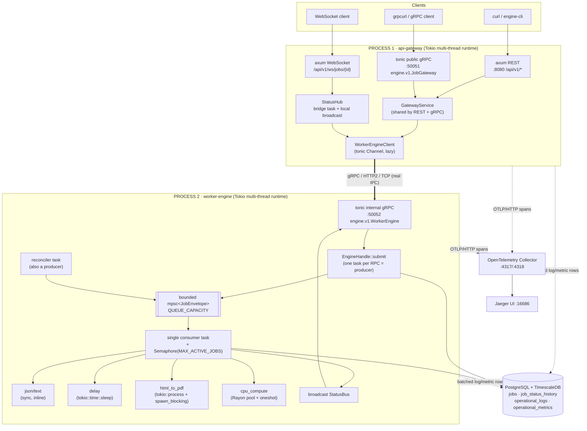

# Architecture

## What runs where



## Process vs binary vs crate vs module

| Term | In this project | Runs on its own? |
|---|---|---|
| **Process** | `api-gateway` and `worker-engine` while running. Separate address spaces, separate Tokio runtimes, separate PIDs. They can only talk over the network (gRPC). | yes |
| **Binary crate** | `apps/api-gateway`, `apps/worker-engine`, `tools/engine-cli` – each has a `main.rs` and becomes an executable. | yes (when started) |
| **Library crate** | `crates/*` – compiled *into* the binaries that depend on them. `engine-application` code runs inside the worker process; `engine-ipc` code runs inside *both*. | no |
| **Module** | a file/namespace inside a crate (`rest.rs`, `dispatcher.rs`, …). | no |

Two binaries ≠ microservices platform: there is exactly one deployable per role,
no service discovery, no broker. The split exists to demonstrate a **real
process boundary** (IPC, independent failure, restart/recovery).

## Crate dependency graph

```text
                 engine-core  (models, errors, state machine, JobStore + JobHandler traits)
                 ▲   ▲   ▲   ▲
   engine-handlers   │   │   engine-persistence (sqlx)
                     │   │
     engine-observability (tracing, OTel, metrics, Timescale writers)
          ▲          ▲
 engine-application  engine-ipc (protobuf/tonic, error<->Status, metadata)
          ▲            ▲       ▲
     worker-engine ────┘       api-gateway        engine-cli / e2e-tests use engine-ipc
```

`engine-core` imports no `axum`, `tonic`, `http` or `sqlx`. Error mapping to HTTP lives in
`apps/api-gateway/src/rest.rs::http_status`, to gRPC in `crates/ipc/src/status.rs`.

## Ports

| Port | Who | Exposure |
|---|---|---|
| 8080 | gateway REST + WebSocket | public (bind 127.0.0.1 by default) |
| 50051 | gateway public gRPC (+ reflection) | public (bind 127.0.0.1 by default) |
| 50052 | worker internal gRPC | **private**: 127.0.0.1 in host mode; not published in Compose |
| 55432 | PostgreSQL/TimescaleDB (host side of 5432) | local only |
| 4317/4318 | OTel Collector OTLP gRPC/HTTP | local only |
| 16686 | Jaeger UI | local only |

## Health and readiness

* `GET /api/v1/health/live` – the gateway process is up (always 200 if it answers).
* `GET /api/v1/health/ready` – the gateway calls worker `Health` (2 s deadline): 200 only if
  the engine is `Ready` **and** a `SELECT 1` succeeds. Otherwise 503 with the reason
  (`starting` = DB not connected yet, `draining` = shutting down, or worker unreachable).
  The body also reports the state of the status stream (`connected`/`disconnected`).

## Request/response flow (submission)

```mermaid
sequenceDiagram
    participant C as Client
    participant G as api-gateway
    participant W as worker-engine (RPC task = producer)
    participant Q as mpsc queue
    participant D as dispatcher (single consumer)
    participant DB as PostgreSQL
    C->>G: POST /api/v1/jobs {job_type, payload}
    G->>G: Tower stack: request id, trace span, concurrency limit
    G->>G: JobCommand::parse (edge validation, 422 on error)
    G->>W: gRPC SubmitJob (traceparent, x-request-id, grpc-timeout)
    W->>W: validate again (never trust the caller)
    W->>Q: try_reserve_owned()  (full → RESOURCE_EXHAUSTED → 429)
    W->>DB: BEGIN; INSERT job 'queued' (+history via trigger); COMMIT
    W->>Q: permit.send(envelope)
    W-->>G: SubmitJobResponse(job)
    G-->>C: 202 Accepted + Location + links
    D->>Q: recv() (after acquiring a semaphore permit)
    D->>DB: UPDATE ... SET status='processing' WHERE status='queued' (atomic claim)
    D->>D: run handler (timeout, cancellation)
    D->>DB: UPDATE ... SET status='completed', result=... WHERE lease matches
    D-->>G: StatusEvent over SubscribeStatus stream
    G-->>C: WebSocket {"type":"status","event":{...}}
```

## Component responsibilities

| Component | File | Responsibility |
|---|---|---|
| Tower stack | `apps/api-gateway/src/middleware.rs` | request ids, server spans, concurrency limit + load shedding, metrics |
| REST | `apps/api-gateway/src/rest.rs` | DTOs, routes, **EngineError → HTTP** |
| Public gRPC | `apps/api-gateway/src/grpc.rs` | same operations, **EngineError → Status** |
| GatewayService | `apps/api-gateway/src/service.rs` | one implementation behind both APIs; IPC calls with deadlines and trace context |
| StatusHub | `apps/api-gateway/src/hub.rs` | one upstream status stream, local fan-out, snapshot-on-gap watchers |
| WebSocket | `apps/api-gateway/src/websocket.rs` | per-connection push loop, ping, bounded connection count |
| Internal gRPC | `apps/worker-engine/src/grpc_server.rs` | adapter over `EngineHandle`; artifact streaming; status stream |
| EngineHandle | `crates/application/src/engine.rs` | admission, durable submission, queries, cancel, shutdown |
| Dispatcher | `crates/application/src/dispatcher.rs` | the single consumer, per-job execution, retries |
| Reconciler | `crates/application/src/reconciler.rs` | lease recovery, DB → queue re-dispatch |
| PgJobStore | `crates/persistence/src/lib.rs` | guarded SQL transitions |
| Handlers | `crates/handlers/src/*.rs` | the actual work, one execution style each |
| Telemetry | `crates/observability/src/*.rs` | tracing/OTel, metrics, Timescale writers |
