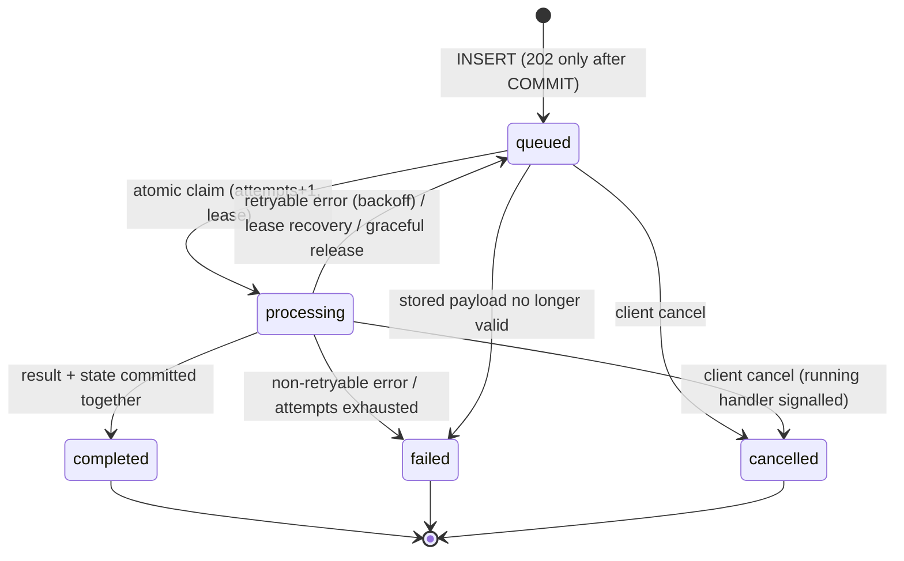

# Data flow: ownership, channels, job lifetime, durability, notifications

## Ownership through the queue

```rust
// crates/application/src/engine.rs  (inside one producer task)
let command = JobCommand::parse(kind, &payload, limits)?;     // owned String fields
let permit  = self.sender.clone().try_reserve_owned()?;      // this producer's own Sender clone
// ... INSERT + COMMIT ...
permit.send(JobEnvelope { job_id, command, traceparent, enqueued_at }); // `command` MOVED in
// `command` can no longer be used here: the compiler enforces single ownership.

// crates/application/src/dispatcher.rs  (the single consumer)
let envelope = receiver.recv().await;                         // MOVED out
running.spawn(execute_job(shared.clone(), envelope, permit)); // MOVED into the job task
```

* No copies of the payload, no locks around it: one owner at every moment.
* `JobCommand` owns its `String`s (not `&str`) because the request that produced it is gone by
  the time the job runs (`'static`).
* `Sender` is `Clone` (many producers); `Receiver` is not (exactly one consumer).
* `shared: Arc<Shared<S>>` is the *shared, read-mostly* state; cloning an `Arc` copies a pointer
  and bumps a counter.

## Who produces, who consumes

| Channel | Type | Producers | Consumer(s) | Why this type |
|---|---|---|---|---|
| job queue | `mpsc::channel(QUEUE_CAPACITY)` | every `SubmitJob` RPC task, the reconciler | **one** dispatcher task | bounded FIFO hand-off with backpressure |
| CPU result | `oneshot` | the Rayon closure | the awaiting job task | exactly one value, once; lets async code wait for a thread pool |
| status fan-out (worker) | `broadcast(STATUS_CHANNEL_CAPACITY)` | job tasks after each commit | one stream per gateway | every subscriber needs every event; lag is detectable |
| status fan-out (gateway) | `broadcast(4096)` | the bridge task | each WebSocket / WatchJob watcher | same, process-local |
| engine state | `watch` | engine lifecycle | health, admission | only the latest value matters |
| upstream state | `watch` | gateway bridge task | readiness endpoint | only the latest value matters |
| watcher output | `mpsc(16)` per watcher | watcher task | WebSocket/gRPC writer | bounded: a slow client slows only itself |
| DB logs | `mpsc(DB_LOG_CAPACITY)` | any thread via `try_send` | one log writer | bounded + drop-on-full: logging never blocks work |

Focused executable demonstrations of all four channel kinds: `crates/application/tests/channels.rs`.

## Job lifetime and states



Enforced twice: `JobStatus::can_transition_to` (Rust) and the `jobs_before_update` trigger
(PostgreSQL). The `jobs_record_history` trigger writes `job_status_history` in the same
statement, and `status_version` increases by one per transition.

## Durable DB vs ephemeral channel

PostgreSQL is the source of truth; the channel is an optimization ("work is probably here").

| Failure point | What remains | Recovery |
|---|---|---|
| queue full before insert | nothing | client gets 429 + `Retry-After` |
| DB down at insert | nothing (slot released) | client gets 503 |
| crash after COMMIT, before `permit.send` | row `queued` | reconciler dispatches it on restart |
| crash while `processing` | row `processing` with lease | restarted worker with the same `WORKER_ID` requeues it immediately; otherwise when `lease_expires_at` passes |
| crash after artifact rename, before `completed` | file + row `processing` | job re-runs; rename replaces the file (at-least-once) |
| result write fails (DB blip) | row `processing` | retried 4× with backoff, then lease expiry → re-run |
| graceful shutdown | running jobs | after `SHUTDOWN_GRACE_MS` cancelled and released to `queued` (attempt not counted) |
| client request times out after COMMIT | row `queued` | job runs anyway; client should poll, or retry with the same `Idempotency-Key` |

Guarantees: **durable acceptance, at-least-once execution, bounded attempts**
(`MAX_ATTEMPTS`; exhausted → `failed` with `attempts_exhausted`). Not exactly-once: a handler
can run twice if a worker dies after doing the work but before committing.

Idempotent claim: `UPDATE ... WHERE id=$1 AND status='queued'` – a duplicate envelope (e.g.
reconciler and submitter both enqueued it) simply matches zero rows. Completion/failure
updates include `lease_owner` and `attempts`, so a stale attempt can never overwrite a newer
one, and a job cancelled mid-run is never flipped to `completed`.

## Admission vs execution

```text
QUEUE_CAPACITY  = how many accepted-but-not-started jobs may wait in memory
MAX_ACTIVE_JOBS = how many run at the same time (semaphore permits)
```

The consumer acquires a permit **before** `recv()`. With all permits taken, jobs stay in the
channel; when it is full, `try_reserve` fails → 429. No unbounded pile of tasks waiting for
permits. Measured (MAX_ACTIVE_JOBS=1, QUEUE_CAPACITY=64, 100 simultaneous submissions):
`{202: 64, 429: 36}` – see `docs/test-report.md`.

## WebSocket bridge (cross-process notifications)

```text
worker job task ── COMMIT ──► broadcast ──► SubscribeStatus (ONE gRPC stream per gateway)
                                                    │
gateway bridge task ◄───────────────────────────────┘  reconnects with backoff, emits Resync on (re)connect
        │
        ▼ local broadcast<HubEvent>
watcher task per client:
  1. subscribe to local broadcast         (first, so nothing falls in between)
  2. fetch snapshot (worker → PostgreSQL) → send {"type":"snapshot"}
  3. for each event of this job with status_version > last sent → send {"type":"status"}
  4. on Lagged / Resync → fetch snapshot again, send if newer
  5. terminal status → close (code 1000)
```

* No process-local `Arc`/`broadcast` crosses the boundary; only protobuf messages do.
* Reconnect = new snapshot of the current truth. There is **no durable event replay** (that
  would need an event log/broker, deliberately out of scope).
* The same watcher backs the public gRPC `WatchJob` stream.
